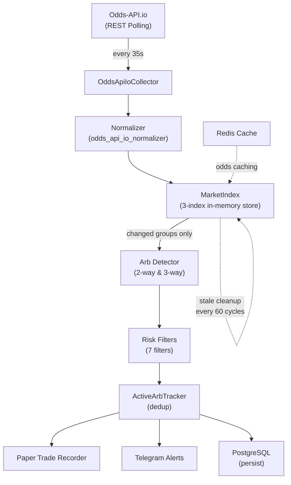

# Sports Arbitrage Odds Scanner — Full Project Overview

## What This Project Does

This is a **real-time sports arbitrage scanner** that monitors odds from multiple bookmakers, detects pricing discrepancies where you can bet on all outcomes of an event and guarantee a profit regardless of the result, and alerts you via Telegram.

---

## Architecture Diagram



---

## Current Configuration (Live Right Now)

| Setting | Value |
|---|---|
| **Data Source** | Odds-API.io (REST polling, incremental mode) |
| **Bookmakers** | Circa, Bally Bet, DraftKings, FanDuel, Bet365 |
| **Sports** | Basketball only |
| **Poll Interval** | 35 seconds |
| **Events per Cycle** | 10 (capped to stay under 5,000 req/hr API limit) |
| **Markets Scanned** | H2H (moneyline), Spreads, Totals |
| **Default Stake** | $1,000 |
| **Min Arb Profit** | 0.5% |
| **Max Arb Profit** | 20% (palp filter) |
| **Stale Odds Threshold** | 60s prematch / 10s live |

---

## Module-by-Module Breakdown

### 1. Data Collection (`backend/collectors/`)

| File | Purpose |
|---|---|
| [odds_api_io.py](file:///c:/Users/ahmed/OneDrive/Desktop/sportsarb/backend/collectors/odds_api_io.py) | **Primary collector.** REST polling: fetches events → fetches odds per event → normalizes. Caps at 10 events/sport. |
| [odds_api_io_normalizer.py](file:///c:/Users/ahmed/OneDrive/Desktop/sportsarb/backend/collectors/odds_api_io_normalizer.py) | Transforms raw Odds-API.io JSON into `NormalizedOdds` models. Applies Iowa-legal operator whitelist filtering here. |
| [odds_api_io_ws.py](file:///c:/Users/ahmed/OneDrive/Desktop/sportsarb/backend/collectors/odds_api_io_ws.py) | **WebSocket collector** (built but not currently active). Would provide near-zero-latency updates. |
| [odds_api.py](file:///c:/Users/ahmed/OneDrive/Desktop/sportsarb/backend/collectors/odds_api.py) | Legacy collector for The Odds API (v4). Fallback mode if no Odds-API.io key is set. |

### 2. Normalization (`backend/normalization/`)

| File | Purpose |
|---|---|
| [models.py](file:///c:/Users/ahmed/OneDrive/Desktop/sportsarb/backend/normalization/models.py) | Core data models: `NormalizedOdds`, `ArbOpportunity`, `EventGroup`, `MarketKey` (h2h/spreads/totals), `MarketStatus`. |
| [normalizer.py](file:///c:/Users/ahmed/OneDrive/Desktop/sportsarb/backend/normalization/normalizer.py) | Legacy normalizer for The Odds API format. |
| [event_matcher.py](file:///c:/Users/ahmed/OneDrive/Desktop/sportsarb/backend/normalization/event_matcher.py) | Groups normalized odds by event → market → period → line for apples-to-apples comparison. |

### 3. Matching Engine (`backend/matcher/`)

This is a sophisticated matching subsystem for cross-source event resolution:

| File | Purpose |
|---|---|
| [team_normalizer.py](file:///c:/Users/ahmed/OneDrive/Desktop/sportsarb/backend/matcher/team_normalizer.py) | Normalizes team names across bookmakers (e.g., "LA Lakers" ↔ "Los Angeles Lakers") |
| [selection_normalizer.py](file:///c:/Users/ahmed/OneDrive/Desktop/sportsarb/backend/matcher/selection_normalizer.py) | Normalizes selection names (Over/Under, team abbreviations) |
| [market_normalizer.py](file:///c:/Users/ahmed/OneDrive/Desktop/sportsarb/backend/matcher/market_normalizer.py) | Normalizes market types across different API formats |
| [market_matcher.py](file:///c:/Users/ahmed/OneDrive/Desktop/sportsarb/backend/matcher/market_matcher.py) | Matches markets across bookmakers |
| [event_resolver.py](file:///c:/Users/ahmed/OneDrive/Desktop/sportsarb/backend/matcher/event_resolver.py) | Resolves events from different sources as the same event |
| [event_scorer.py](file:///c:/Users/ahmed/OneDrive/Desktop/sportsarb/backend/matcher/event_scorer.py) | Scoring algorithm for event match confidence |
| [league_normalizer.py](file:///c:/Users/ahmed/OneDrive/Desktop/sportsarb/backend/matcher/league_normalizer.py) | Normalizes league names |
| [deduper.py](file:///c:/Users/ahmed/OneDrive/Desktop/sportsarb/backend/matcher/deduper.py) | Deduplication logic |

### 4. Arb Detection Engine (`backend/engine/`)

| File | Purpose |
|---|---|
| [market_index.py](file:///c:/Users/ahmed/OneDrive/Desktop/sportsarb/backend/engine/market_index.py) | **Three-index architecture** for incremental updates. Only recomputes changed market groups instead of scanning everything each cycle. Indexes by: market key, operator, and event. |
| [arb_detector.py](file:///c:/Users/ahmed/OneDrive/Desktop/sportsarb/backend/engine/arb_detector.py) | Core detection: finds best odds per selection from distinct operators → validates complementary selections → checks if implied probability sum < 1 → computes stakes. Supports 2-way and 3-way arbs. |
| [stake_calculator.py](file:///c:/Users/ahmed/OneDrive/Desktop/sportsarb/backend/engine/stake_calculator.py) | Equal-payout stake calculation given decimal odds and total stake. |
| [risk_filters.py](file:///c:/Users/ahmed/OneDrive/Desktop/sportsarb/backend/engine/risk_filters.py) | **7 risk filters** applied in order (see below). |
| [poll_scheduler.py](file:///c:/Users/ahmed/OneDrive/Desktop/sportsarb/backend/engine/poll_scheduler.py) | Adaptive per-sport scheduling with tiers: prematch (60s), live (15s), near-start (15s), burst (8s), backoff (300s). |
| [active_arb_tracker.py](file:///c:/Users/ahmed/OneDrive/Desktop/sportsarb/backend/engine/active_arb_tracker.py) | Prevents duplicate alerts for the same arb opportunity. |

### 5. Risk Filters (7 Layers)

Applied in this order (cheapest checks first):

| # | Filter | What It Does |
|---|---|---|
| 1 | **Suspended Markets** | Rejects if any leg has a suspended/closed market |
| 2 | **Minimum Profit** | Rejects arbs below 0.5% profit (not worth the effort) |
| 3 | **Palpable Error** | Rejects arbs above 20% profit (likely a bookmaker mistake that will be voided) |
| 4 | **Stale Odds** | Rejects if any leg's odds are >60s old (prematch) or >10s old (live) |
| 5 | **Freshness Gap** | Rejects if cross-book timestamps differ by >15s prematch / >5s live |
| 6 | **Mismatched Lines** | For spreads/totals: ensures all legs have the same absolute point value |
| 7 | **Iowa College Props** | Regulatory: blocks player prop bets on Iowa college teams |

### 6. Alerts & Storage

| File | Purpose |
|---|---|
| [telegram.py](file:///c:/Users/ahmed/OneDrive/Desktop/sportsarb/backend/alerts/telegram.py) | Sends formatted arb alerts and status messages to your Telegram chat |
| [redis_cache.py](file:///c:/Users/ahmed/OneDrive/Desktop/sportsarb/backend/storage/redis_cache.py) | Caches normalized odds in Redis |
| [db.py](file:///c:/Users/ahmed/OneDrive/Desktop/sportsarb/backend/storage/db.py) | PostgreSQL connection (async via SQLAlchemy) |
| [models.py](file:///c:/Users/ahmed/OneDrive/Desktop/sportsarb/backend/storage/models.py) | DB models for persisting arb records |

### 7. Paper Trading (`backend/paper_trading/`)

> [!IMPORTANT]
> Paper trading is a **simulated trading system** — it records what would have happened if you placed bets on detected arbs, without risking real money.

| File | Purpose |
|---|---|
| [paper_trade_models.py](file:///c:/Users/ahmed/OneDrive/Desktop/sportsarb/backend/paper_trading/paper_trade_models.py) | Data models: `PaperTrade`, `PaperTradeStatus` |
| [paper_trade_recorder.py](file:///c:/Users/ahmed/OneDrive/Desktop/sportsarb/backend/paper_trading/paper_trade_recorder.py) | Freezes each arb alert into a paper trade record with full snapshot |
| [paper_trade_rechecker.py](file:///c:/Users/ahmed/OneDrive/Desktop/sportsarb/backend/paper_trading/paper_trade_rechecker.py) | Re-checks recorded trades to see if the arb survived (odds still valid) |
| [paper_trade_reporter.py](file:///c:/Users/ahmed/OneDrive/Desktop/sportsarb/backend/paper_trading/paper_trade_reporter.py) | Generates performance summaries (win rate, survival rate, P&L) |

---

## How One Scan Cycle Works

```
1. For each sport (currently: basketball)
   │
   ├─ Fetch up to 100 events from /v3/events
   ├─ Cap to 10 events (API rate limit protection)
   │
   ├─ For each event:
   │   ├─ Fetch odds from /v3/odds?bookmakers=Circa,Bally+Bet,DraftKings,FanDuel,Bet365
   │   ├─ Normalize into NormalizedOdds (filter to Iowa-legal operators)
   │   └─ Upsert into MarketIndex
   │
   ├─ MarketIndex returns which market groups changed
   │
   ├─ For each changed group with 2+ operators:
   │   ├─ Run 2-way or 3-way arb detection
   │   ├─ Apply 7 risk filters
   │   ├─ Deduplicate via ActiveArbTracker
   │   ├─ Record paper trade
   │   └─ Send Telegram alert
   │
   └─ Log cycle diagnostics

2. Sleep for remaining time (35s - elapsed)
3. Repeat
```

---

## Key Numbers from Latest Cycle

From the bot output just now:

| Metric | Value |
|---|---|
| Events fetched | 100 (capped to 10 for odds) |
| Odds lines collected | 254 |
| Active bookmakers | bet365, draftkings, fanduel |
| Changed market groups | 119 |
| Groups with 2+ bookmakers | 32 |
| Potentially complementary groups | 68 |
| Candidate arbs found | 0 |
| Rejection reasons | `same-operator` and `below min (0.5%)` |

---

## Iowa-Legal Operator Whitelist

Only odds from these operators are processed (configured in `config.py`):

| Operator Key | Display Name |
|---|---|
| `draftkings` | DraftKings |
| `fanduel` | FanDuel |
| `betmgm` | BetMGM |
| `williamhill_us` | Caesars |
| `fanatics` | Fanatics |
| `betrivers` | BetRivers |
| `bet365` | Bet365 |
| `circasports` | Circa Sports |
| `espnbet` | ESPN BET |
| `qsportsbook` | Q Sportsbook |
| `sporttrade` | Sporttrade |
| ~~`hardrockbet`~~ | ~~Hard Rock~~ (disabled: 77% phantom arbs) |

---

## Infrastructure

| Component | Technology | Status |
|---|---|---|
| Language | Python 3.12+ (async) | ✅ |
| Odds Data | Odds-API.io REST | ✅ Active |
| Odds Data (WS) | Odds-API.io WebSocket | 🔧 Built, not active |
| Odds Data (Legacy) | The Odds API v4 | ⏸️ Fallback |
| Cache | Redis 7 | ✅ (via Docker) |
| Database | PostgreSQL 16 | ✅ (via Docker) |
| Alerts | Telegram Bot API | ✅ |
| Deployment | Local (Windows) | ✅ |

---

## Current Limitations & Potential Improvement Areas

> [!NOTE]
> These are observations based on the current code, not criticisms. Listed here for your feedback.

1. **Only 1 sport active** — configured for `basketball` only; the system supports 9 sports
2. **Only 3 of 5 bookmakers returning data** — Circa and Bally Bet returned no odds for the events polled (they may have limited basketball coverage)
3. **10-event cap per sport** — conservative to avoid rate limits, but may miss arbs on less-popular events
4. **REST polling at 35s intervals** — WebSocket mode is built but not active; WS would provide near-instant odds updates
5. **Bookmaker hardcoded in `main.py`** — the bookmaker list is hardcoded on line 283 instead of reading from config/env
6. **No odds from BetMGM, Caesars, BetRivers, ESPN BET** — these are in the Iowa-legal whitelist but not in the API's selected bookmakers
7. **Paper trading only** — no mechanism for actual bet placement (by design for safety)
8. **`same-operator` rejections** — many potential arbs rejected because the best price on both sides comes from the same bookmaker (need more bookmaker diversity)
9. **`below min` rejections** — some arbs exist below the 0.5% threshold; could lower this if transaction costs are minimal
